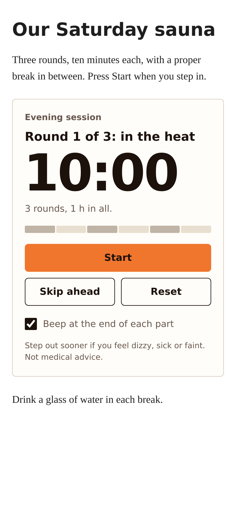

# Sauna Timer Block for WordPress

A WordPress plugin that puts a sauna round timer on any post or page: time in the heat, a break, repeat, then a final cool-down. Add it as a **block**, or type the **`[sauna_timer]` shortcode**.

Made by [DIVELUX](https://diveluxsaunahat.com), a small family brand in Irvine, California that makes handmade wool sauna hats. More free tools: <https://diveluxsaunahat.com/pages/sauna-tools>



The timer is the open-source [`<sauna-timer>` web component](https://github.com/divelux/sauna-timer-element), bundled inside the plugin. The plugin adds the block, the shortcode, a small settings page, and loads the script only where a timer is shown.

> **Not medical advice.** The limits below are bounds for a timer, not recommendations. The timer itself tells visitors to step out sooner if they feel dizzy, sick or faint.

## What you get

- **Block:** "Sauna Timer" in the Widgets category; rounds, minutes, break, cool-down, beep and heading in the sidebar
- **Shortcode:** `[sauna_timer rounds="3" heat="10" rest="10" cooldown="10" muted="yes" heading="Evening session"]`
- **Settings > Sauna Timer:** site-wide defaults and an opt-in credit line
- **No external requests.** The script is served from your site. No fonts, analytics, cookies, or calls home
- The script is enqueued only on pages that render a timer, deferred, in the footer
- One option in the database (`wpst_defaults`), removed by `uninstall.php`

| Shortcode attribute | Range | Default |
| --- | --- | --- |
| `rounds` | 1–6 | 3 (or Settings) |
| `heat` | minutes per round, 1–35 | 10 (or Settings) |
| `rest` | minutes of break, 1–30 | 10 (or Settings) |
| `cooldown` | minutes of final cool-down, 1–30 | same as `rest` |
| `muted` | `yes` / `no` | `no` (or Settings) |
| `heading` | short text | none |

Numbers outside a range are pulled back into it; junk falls back to the default.

## Install

1. Zip the folder without the development files (the `.distignore` list), or use `wp-sauna-timer.zip` from a release.
2. Plugins > Add New > Upload Plugin, choose the zip, activate.
3. Optional: Settings > Sauna Timer.

Requires WordPress 6.3 or newer (block API version 3, deferred scripts) and PHP 7.4 or newer.

## Security notes

- Every shortcode and block value is clamped to an integer (`absint`) or cleaned with `sanitize_text_field` and printed with `esc_attr`.
- The block saves no HTML (`save` returns `null`); the server renders it, so editor input never reaches the page unescaped.
- The settings page uses the Settings API: `settings_fields()` prints the nonce, `options.php` checks it and the `manage_options` capability, and `register_setting` runs a sanitize callback.
- Direct file access is blocked (`ABSPATH` check); `uninstall.php` checks `WP_UNINSTALL_PLUGIN`.
- The credit link is **off** unless the site owner turns it on, as WordPress.org guideline 10 asks.

## Files

| File | What it is |
| --- | --- |
| `wp-sauna-timer.php` | The plugin: shortcode, block render, settings page |
| `blocks/sauna-timer/block.json` | Block metadata (API version 3) |
| `blocks/sauna-timer/editor.js` | Editor UI, plain JavaScript, no build step |
| `assets/sauna-timer.iife.js` | The bundled `<sauna-timer>` element 1.0.0 |
| `uninstall.php` | Deletes the option |
| `readme.txt` | The WordPress.org readme |
| `.wordpress-org/` | Directory assets: icon and screenshot |
| `tests/check.py` | Static checks: readme header, versions, escaping, no network calls, PHP syntax |
| `tests/preview.html` | The exact markup the plugin renders, for a browser check without WordPress |

## Checks

```sh
python3 tests/check.py
```

It checks the readme.txt header against the WordPress.org format (tags ≤ 5, short description ≤ 150 characters, "Tested up to" as a major version), one version number everywhere, that every `echo` is escaped, that nothing calls the network, that the credit is opt-in, and, if `tree-sitter-php` is installed, parses every PHP file for syntax errors.

What has been checked so far: the static checks above and the PHP syntax parse with tree-sitter-php; `tests/preview.html` rendered in headless Chromium at 375, 390, 768 and 1280 px with no console errors and no network requests. **Not yet checked:** `php -l` with a real PHP binary and a run inside a live WordPress install (block editor, settings save). Run Plugin Check (`wp plugin check wp-sauna-timer`) before submitting.

## License

MIT, © 2026 DIVELUX Inc. MIT is compatible with the GPL, as WordPress.org requires.
